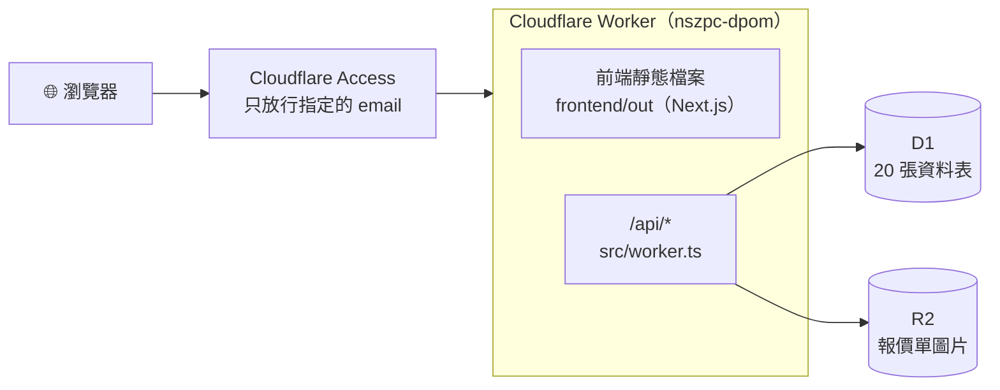
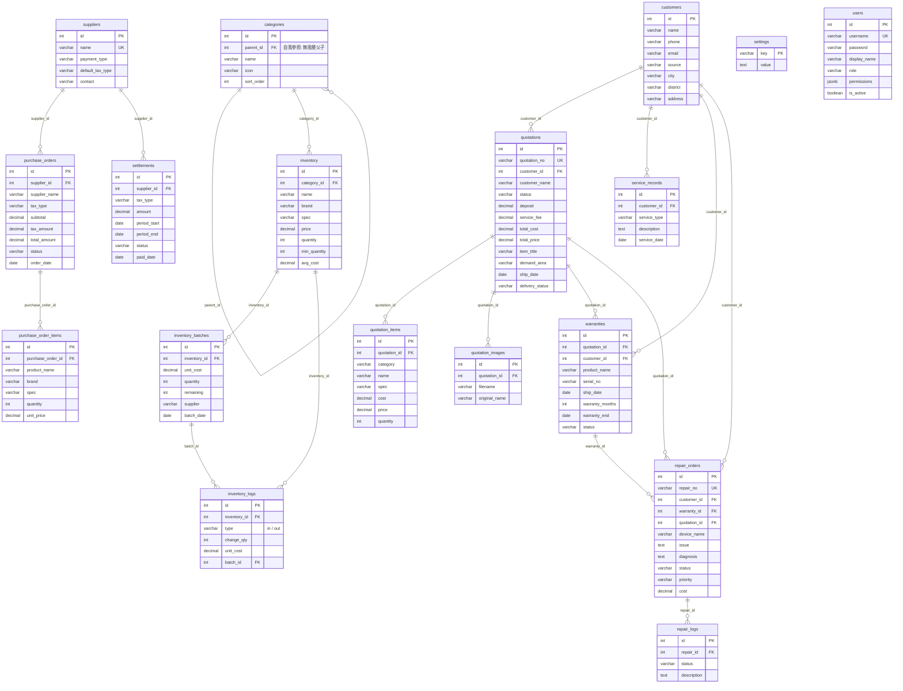

# 星辰電腦 NSZPC 管理系統

內網使用的星辰電腦管理系統，涵蓋庫存管理、訂單管理、叫貨與結款、客戶關係管理、社群追蹤等功能。

## 系統架構

整個系統是一個 Cloudflare Worker（免費方案），放在 Cloudflare Access 後面：



- 網址：<https://dpom.bluz.dev>（先給客戶 demo，之後可以換成客戶自己的網域）
- **登入**：Cloudflare Access 先要求登入（email 收驗證碼或 Google），Worker 再自己驗一次 Access 的 JWT
  （`src/lib/access.ts`：RS256 簽章、iss、aud、效期），用 email 對到 `users` 資料表，角色、頁面權限照舊。網站不存密碼
- 第一次登入：`wrangler.jsonc` 的 `BOOTSTRAP_ADMIN_EMAILS` 裡的人自動建成管理員；其他人由管理員在「權限管理」新增 email，
  **而且要把同一個 email 加進 Access 應用的允許清單**，兩邊都有才進得來

## 技術架構

| 層級 | 技術 |
|------|------|
| 語言 | TypeScript |
| 後端 | Cloudflare Workers（`src/lib/router.ts` 是很小的 Express 相容層，routes 沿用原本的寫法） |
| 資料庫 | Cloudflare D1（SQLite），`migrations/` |
| 圖片 | Cloudflare R2 |
| 登入 | Cloudflare Access |
| 前端 | Next.js（靜態輸出）+ Bootstrap 5 |
| 圖表 | Chart.js |

### D1 的限制（改程式時要注意）

- **免費方案每個請求最多 50 個查詢**（batch 裡每一句都算），一句 SQL 最多 100 個參數
  - 多筆寫入用 `json_each(?)` 一句寫完（例如報價單明細、叫貨明細），不要一筆一個查詢
  - 分類一次讀全部、在記憶體算路徑和子分類（`loadCategories`、`categoryPath`、`descendantIds`）
  - 扣庫存、還原庫存先把要動的資料一次讀出來，在 JS 算好，再用一個 batch（同一個交易）寫回去
- SQL 用 pg 的寫法也可以：`pool.query` 會把 `$1` 換成 `?1`、`NOW()` 換成 ISO 時間。PostgreSQL 專用的語法
  （`to_char`、`::date`、`ILIKE`）要改：年月用 `taipeiMonthSql()`，ISO 週用 `isoWeekRange()`
- 時間欄位存 UTC 的 ISO 字串；「今天」「這個月」用台灣時間（`taipeiDate()`）

## ER Model



### 資料表關聯說明

| 模組 | 資料表 | 說明 |
|------|--------|------|
| **庫存** | `categories` | 自我參照的無限層分類樹 (parent_id → id) |
| | `inventory` | 商品主表，歸屬於分類 |
| | `inventory_batches` | 進貨批次，支援 FIFO / 加權平均成本計算 |
| | `inventory_logs` | 進出貨異動紀錄 |
| **訂單** | `quotations` | 估價單/訂單主表，關聯客戶 |
| | `quotation_items` | 訂單零件明細 |
| | `quotation_images` | 訂單附件圖片 |
| **客戶** | `customers` | 客戶資料，含來源/地區追蹤 |
| | `service_records` | 客戶服務紀錄 (組裝/維修/升級) |
| **進貨** | `suppliers` | 盤商設定 (結款方式/稅別) |
| | `purchase_orders` / `_items` | 叫貨訂單與明細 |
| | `settlements` | 對帳結款紀錄 |
| **售後** | `warranties` | 保固管理，關聯訂單+客戶 |
| | `repair_orders` | 維修工單 |
| | `repair_logs` | 維修進度紀錄 |
| **系統** | `users` | 使用者帳號與頁面級權限 |
| | `settings` | 系統設定 (key-value) |

## 功能特色

### 1. 庫存管理
- **左側分類樹 + 右側表格**雙欄佈局
- **任意深度分類**：例如 CPU > AMD > AM5（三層），顯示卡 > 華碩（兩層）
- **進貨/出貨管理**：批次進貨記錄、FIFO 或加權平均成本計算
- **批次明細**：每件商品可查看進貨批次、異動紀錄、FIFO 成本 vs 均價
- 成本/售價/利潤計算、低庫存警示
- 圖表視覺化（數量分佈、成本 vs 售價）

### 2. 訂單管理
- 訂單建立與管理，支援多個同分類項目
- **客戶搜尋下拉選單**：自動關聯客戶，帶入地區資訊
- **服務費**獨立欄位、自動計算毛利與毛利率
- 訂單狀態：尚未成交 → 已付訂金 → 尚未結單 → 已完成
- 訂單類型：備料中 / 組裝中 / 測試中 / 待出貨 / 已出貨 / 已送達
- **雙重篩選**：狀態 + 類型可組合篩選
- **項目拖曳排序**：拖曳手把調整零件順序
- **圖片附件上傳**（每筆訂單可上傳多張圖片）
- **匯出訂單**：自訂有效天數、自動帶入客戶物流資訊
- **出機檢查單**：完整 QC 表格匯出（OS/BIOS、OCCT、R23、AIDA64+FURMARK 等）
- **成交自動建檔**：訂單成交時自動將客戶新增至客戶管理

### 4. 客戶關係管理
- 客戶來源追蹤：YouTube、Instagram、Line、門市、朋友介紹
- **台灣地區分佈地圖**視覺化
- 服務紀錄（組裝、維修、升級等）
- 來源分佈統計圖表
- 與訂單雙向關聯

### 5. 進貨與結款
- 盤商管理（結款方式：週結/月結/貨到付款）
- 叫貨訂單建立與到貨入庫
- 含稅/未稅自動計算
- 結款紀錄管理（待結/已結）

### 6. 售後服務
- **保固管理**：自動計算到期日（過期自動顯示「已過期」），到期提醒，可以標記「已報修」
- **維修工單**：建單 → 診斷 → 維修 → 完成，完整流程追蹤
- 維修進度日誌

### 7. 社群追蹤
- **YouTube**：設定 API Key + 頻道 ID，由 Worker 查訂閱數／觀看次數／影片數（快取一小時；金鑰只存在伺服器，不會送到瀏覽器）
- **Instagram**：手動輸入追蹤數（IG 沒有開放查詢）

### 8. 權限管理
- 使用者帳號管理（管理員/一般使用者）
- **頁面級權限控制**：管理員可設定每位使用者可存取的頁面
- 登入/登出

### 9. 儀表板
- 庫存品項/成本/利潤統計卡片
- YouTube 訂閱數、Instagram 追蹤數
- **當月訂單狀況**：狀態卡片 + 訂單類型 badge
- 庫存分類圖表
- 低庫存警示、保固到期、未結款、進行中維修通知

## 快速開始

### 前置需求

- Node.js 22+
- Cloudflare 帳號（`npx wrangler login`）

### 本地開發

```bash
npm install
npm --prefix frontend install
cp .dev.vars.example .dev.vars   # 本機不經過 Access，直接用 DEV_USER_EMAIL 登入（只在 localhost 有效）

npm run dev        # API + 本機 D1/R2：http://localhost:8787（前端用 frontend/out，要先 npm run build）
npm run dev:web    # 前端開發模式：http://localhost:3000（/api 轉到 8787）
npm test           # API 整合測試（要先開著 npm run dev）
```

### 部署

```bash
npm run deploy     # 型別檢查 → 前端 build → 套用 D1 migration → 部署 Worker
```

第一次部署之前，D1（`nszpc-dpom`）和 R2（`nszpc-dpom-uploads`）已經建好，id 在 `wrangler.jsonc`。

### Cloudflare Access（登入）

Cloudflare 後台 › Zero Trust › Access › Applications：

1. Add an application › **Self-hosted**，名稱 `nszpc-dpom`
2. Public hostname：`dpom.bluz.dev`，**path 留空**（整個網站都要登入）
3. Policy：Allow，Include › Emails 填所有要用系統的人的 email
4. 打開 `https://dpom.bluz.dev/api/version` 以外的網址會被轉去登入頁，網址裡 `kid=` 後面那串就是 AUD；
   填進 `wrangler.jsonc` 的 `ACCESS_AUD`，再 `npm run deploy`

### 備份與還原

- `npm run db:backup`：匯出成 `backup.sql`
- D1 會自動保留 30 天內任一時間點：`npx wrangler d1 time-travel restore nszpc-dpom --timestamp=<時間>`

## 專案結構

```
├── src/
│   ├── worker.ts              # Worker 入口（掛 routes、登入檢查、安全標頭）
│   ├── lib/
│   │   ├── router.ts          # Express 相容層
│   │   ├── access.ts          # Cloudflare Access JWT 驗證
│   │   ├── specs.ts           # 訂單品項 → 規格（發布到官網、檢測表用）
│   │   └── inspection.ts      # 檢測表的預設項目
│   ├── types/                 # TypeScript 型別定義
│   ├── models/
│   │   └── database.ts        # D1 存取 + 成本計算 + 扣庫存
│   └── routes/
│       ├── auth.ts            # 登入檢查與使用者管理
│       ├── inventory.ts       # 庫存 + 分類 + 進出貨
│       ├── quotations.ts      # 訂單管理 + 圖片（R2）
│       ├── publish.ts         # 訂單發布到官網（RPC 到 NSZ_PC）
│       ├── inspections.ts     # 出機檢測表
│       ├── customers.ts       # 客戶管理
│       ├── purchases.ts       # 叫貨訂單 + 結款管理
│       ├── reports.ts         # 報表 + 保固 + 維修 + 匯出
│       └── settings.ts        # 設定 + YouTube 查詢 + IG 手動輸入
├── migrations/                # D1：資料表（0001）、預設資料（0002）、之後的變更（0003～）
├── frontend/                  # Next.js 前端（npm run build 輸出到 frontend/out）
├── tests/api.test.ts          # API 整合測試
├── wrangler.jsonc
└── package.json
```

## 注意事項

- 整個網站在 Cloudflare Access 後面，沒登入連頁面都看不到；`workers.dev` 和預覽網址已關閉
- LINE Notify 服務在 2025-03-31 結束，LINE 通知功能已經拿掉；之後要通知可以改用 LINE Messaging API
- Instagram 沒有開放查詢，追蹤數用手動輸入
